# 🗡️ Portofolio New Style — Portofolio Bima Fadi Lana

Website portofolio personal bertema **adventure RPG generik** ("ala Zelda", aman lisensi):
pemilik berperan sebagai **Hero**, proyek adalah **Dungeons**, keahlian adalah
**Inventory**, sertifikat adalah **Hall of Relics**, dan kontak adalah **Final Quest**.

Dibangun berdasarkan **PRD v1.4** dan **mockup v3** yang telah disetujui pemilik.

| Aspek | Detail |
| --- | --- |
| **Tema** | Adventure RPG — start screen, loading screen, mini-game |
| **Frontend** | React 19 + Vite + TypeScript + Tailwind CSS v4 |
| **Backend konten** | PHP + SQLite (satu file API, tanpa layanan eksternal) |
| **Panel admin** | `/admin` — CRUD konten, UI sederhana |
| **Bahasa** | Indonesia (default) & English |
| **Performa** | JS awal ±100 KB gzip · background 17 KB — ringan & cepat |
| **Deploy** | Server sendiri (PHP) — lihat `ADMIN.md` |

---

## 🎨 Mockup (v3 — Disetujui)

Desain final yang menjadi acuan pembangunan. Background memakai ilustrasi
*pixel Sky + awan + rumput* sesuai contoh pemilik; semua informasi penting
selalu berada di kartu/dialog krem agar mudah dibaca.

📄 **PDF lengkap:** [mockup-portofolio-zelda-v3.pdf](docs/mockup-portofolio-zelda-v3.pdf)

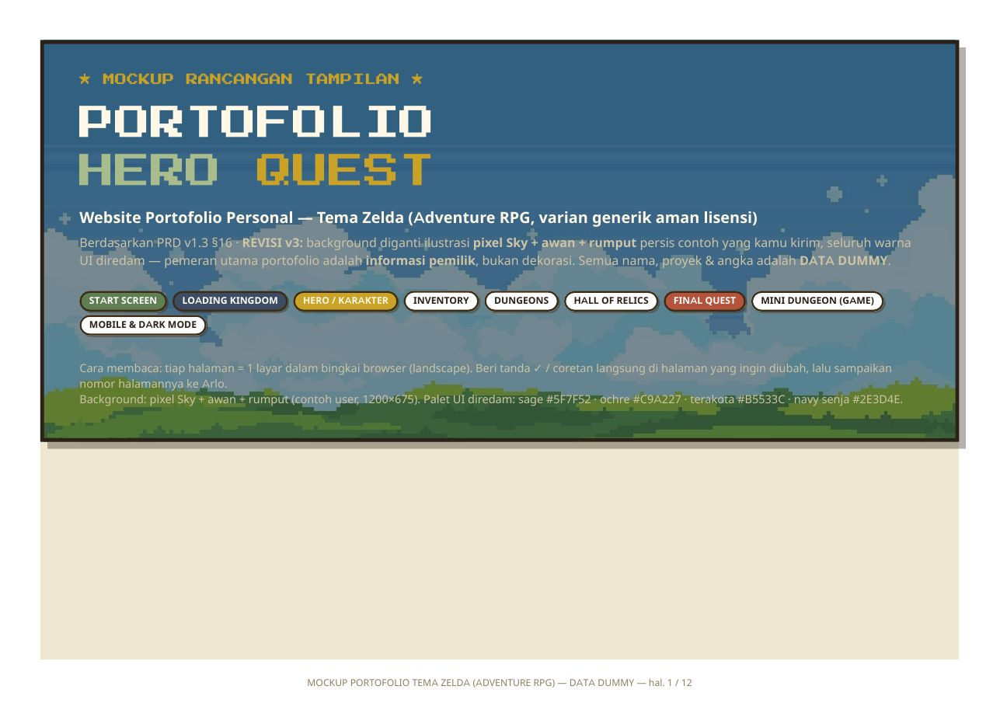

### 1 — Start Screen "PRESS START"

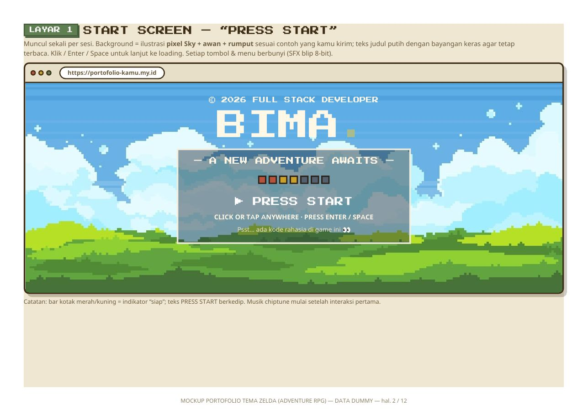

### 2 — Loading Screen "Loading the Kingdom…"

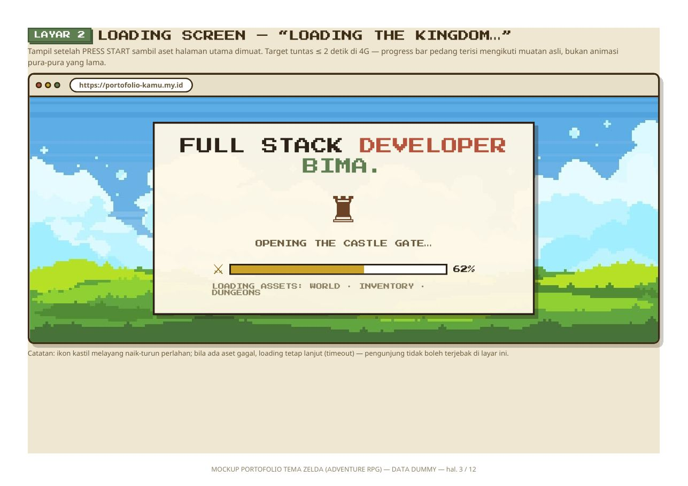

### 3 — Beranda / Hero

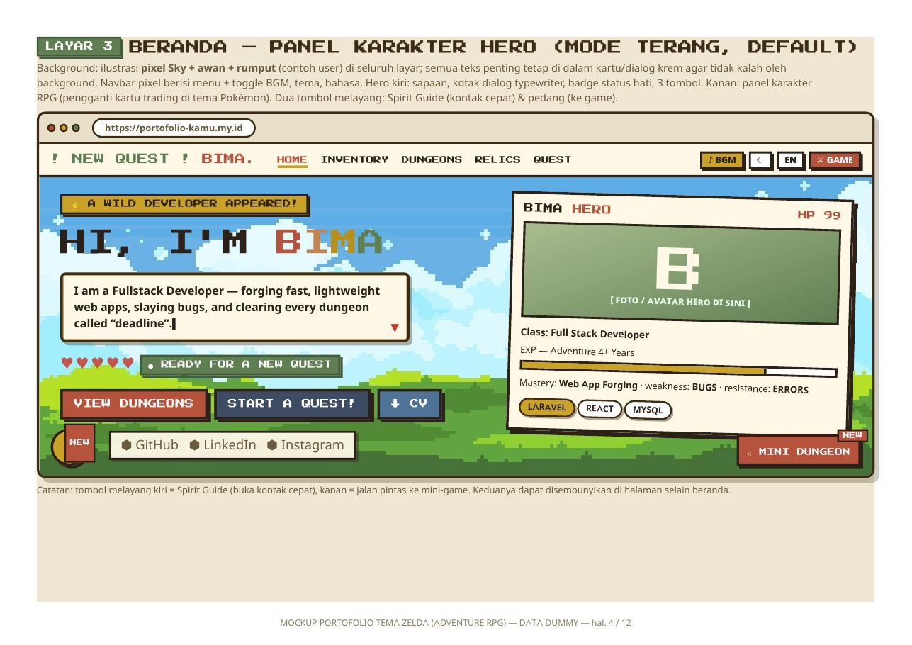

### 4 — Inventory (Keahlian)

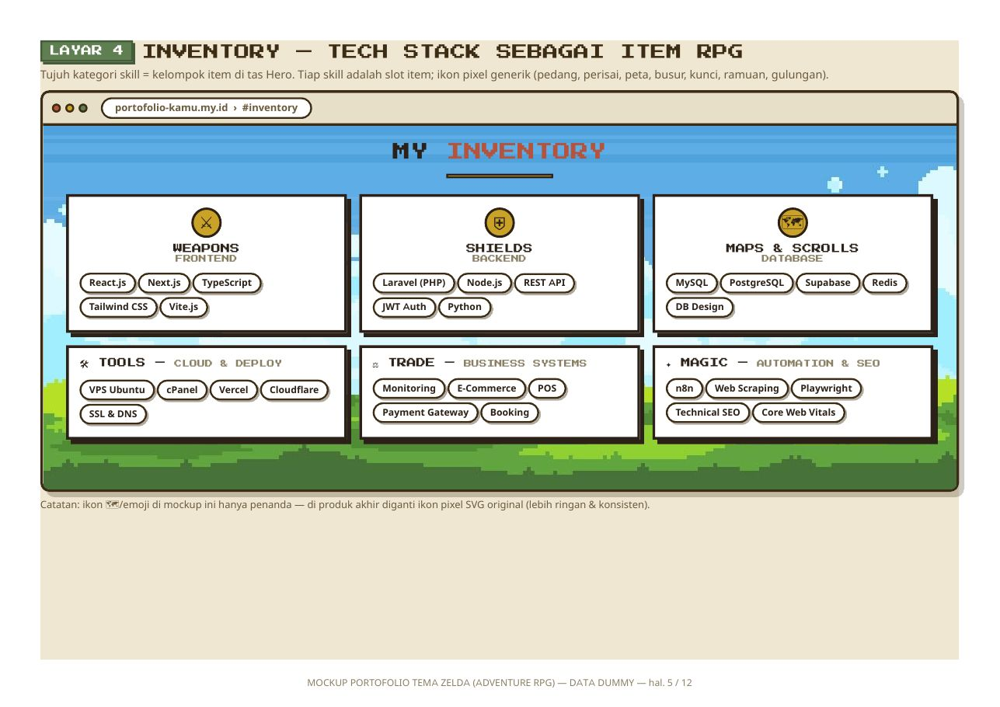

### 5 — Dungeons (Proyek)

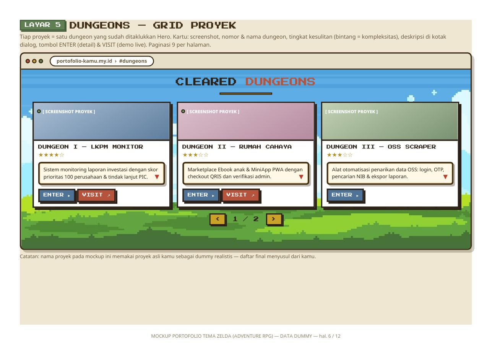

### 6 — Hall of Relics & Adventure Log

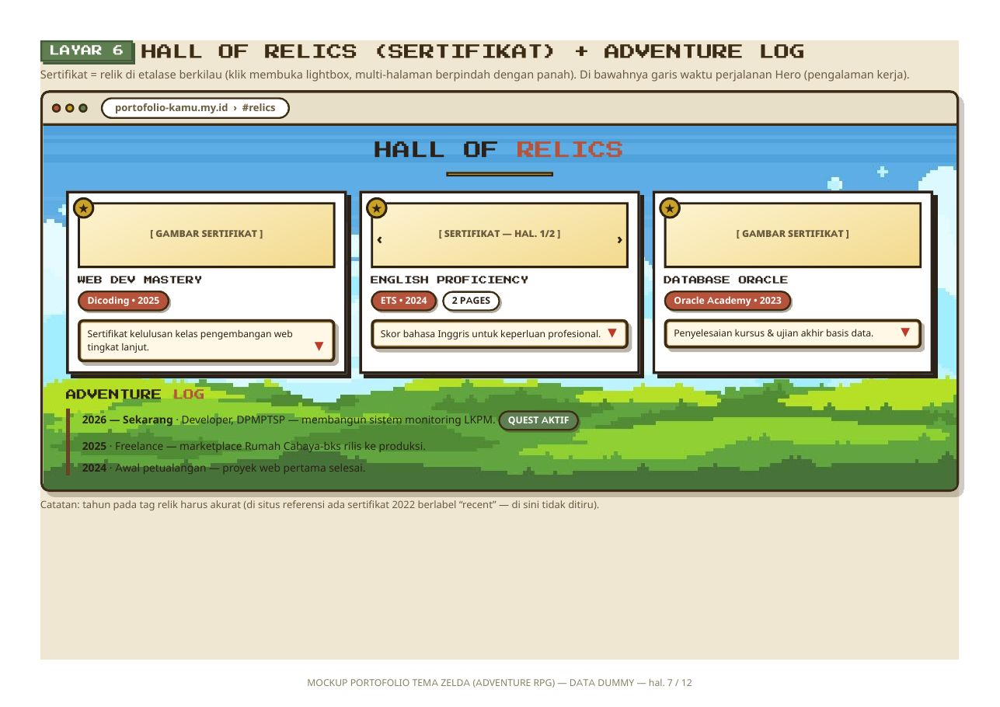

### 7 — Final Quest (Kontak) & Footer

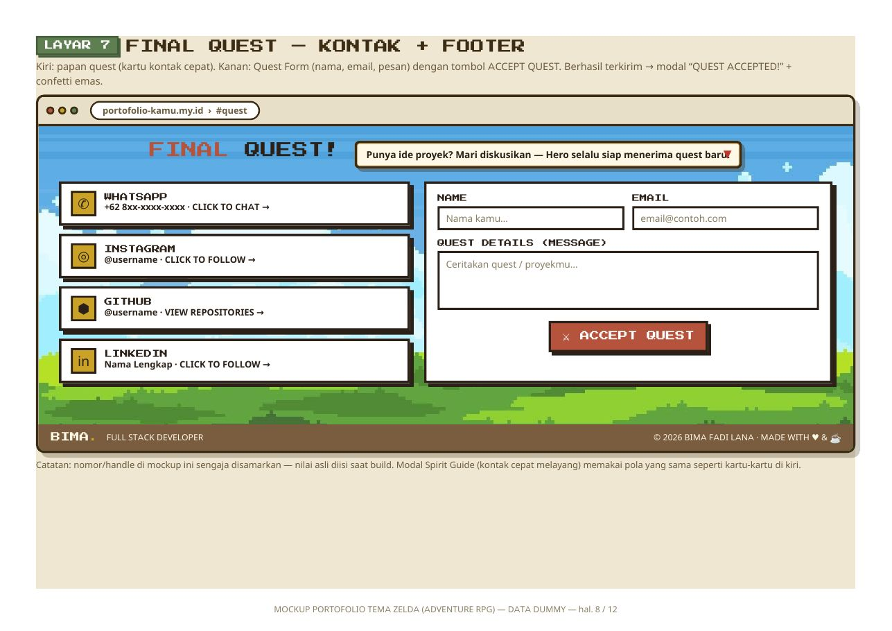

### 8 — Quest Log (Detail Proyek)

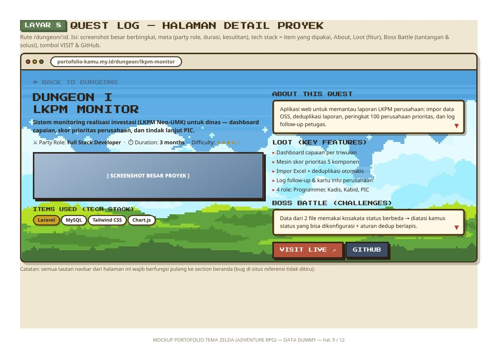

### 9 — Mini Dungeon (Mini-Game)

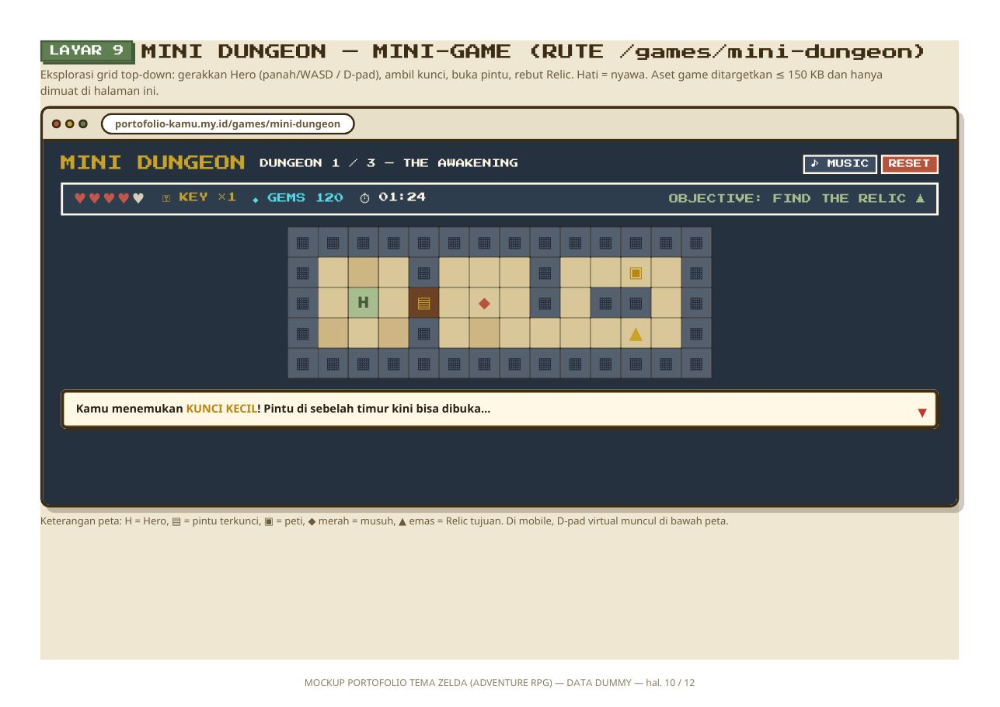

### 10 — Mobile & Dark Mode

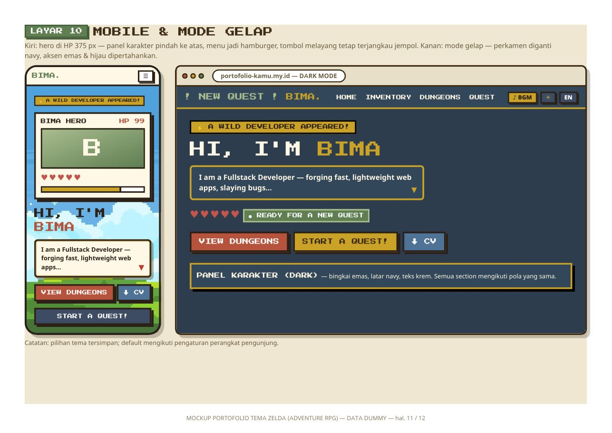

### 11 — Design System

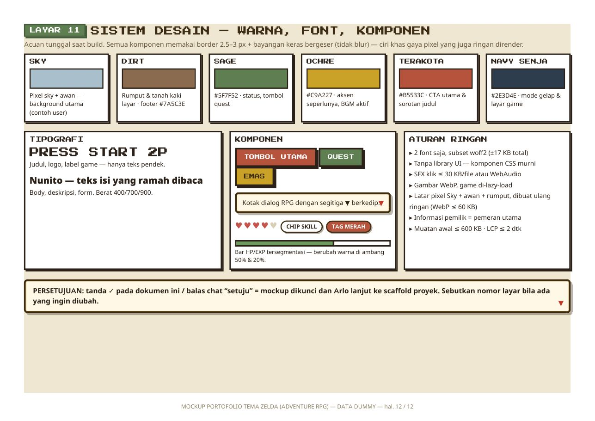

---

## ✨ Fitur

- **Start & loading screen** bergaya game (tampil sekali per sesi)
- **Setiap klik menu/tombol berbunyi** — SFX 8-bit WebAudio (0 KB file) + musik chiptune (BGM) dengan tombol on/off
- **Hero & panel karakter** — hati, EXP, kelas, status "Siap Menerima Quest Baru"
- **Inventory** — 6 kategori keahlian dengan level bar
- **Dungeons** — grid proyek + halaman detail *Quest Log* (fitur = *Loot*, tantangan = *Boss Battle*)
- **Hall of Relics** — sertifikat dengan viewer multi-halaman
- **Adventure Log** — garis waktu perjalanan karier
- **Final Quest** — kartu kontak + form (modal "QUEST ACCEPTED!")
- **Mini Dungeon** — mini-game 3 dungeon yang bisa dimainkan (kunci, pintu, peti, musuh patroli; progres tersimpan)
- **Easter egg** — ketik `coin` di halaman mana pun
- **Dwibahasa** ID/EN · **Dark mode** · **Responsif** penuh
- **Panel admin CRUD** untuk semua konten — tanpa perlu menyentuh kode

## 🧱 Teknologi

- **React 19 + Vite + TypeScript** — SPA cepat, route game & admin di-*lazy load*
- **Tailwind CSS v4** — tema pixel (font Press Start 2P + Nunito)
- **WebAudio API** — seluruh SFX & BGM disintesis, tanpa file audio
- **PHP 8 + SQLite (PDO)** — `server/api.php`: konten publik, login admin, CRUD
- SEO lengkap: meta OG, Twitter Card, JSON-LD Person + WebSite, sitemap-ready

## 📁 Struktur Proyek

```
src/
  data/content.ts     <- konten bawaan (fallback bila API belum terpasang)
  lib/                <- audio (SFX/BGM), i18n (ID/EN), store, klien konten
  components/         <- Boot (start/loading), Navbar, Hero, Sections, ui
  pages/              <- Home, ProjectDetail, MiniDungeon (game)
  admin/              <- panel admin /admin (UI sederhana) + klien API
server/
  api.php             <- API PHP + SQLite (konten, login, CRUD)
  seed.json           <- data awal (terisi otomatis saat pertama diakses)
  config.example.php  <- contoh konfigurasi akun admin
public/assets/        <- bg-sky.webp (17 KB), og-image.jpg, CV
docs/mockup/          <- gambar mockup v3 (galeri di atas) + PDF
```

## 🚀 Menjalankan Lokal

```bash
npm install
npm run dev       # pengembangan (situs tampil dengan data bawaan)
npm run build     # build produksi -> dist/
npm run preview   # pratinjau hasil build
```

Menguji beserta API & panel admin secara lokal — lihat **ADMIN.md**
(bagian "Menguji di komputer lokal").

## 🔐 Panel Admin

Konten situs (proyek, sertifikat, keahlian, perjalanan, kontak/pengaturan)
diubah lewat **`/admin`** dengan login email + password. Backend-nya cukup
PHP + SQLite di server sendiri. Panduan pemasangan & keamanan: **ADMIN.md**.

## 🗺️ Status & TODO

- [x] Start screen + loading screen (sekali per sesi)
- [x] Hero, Inventory, Dungeons + detail, Relics, Adventure Log, Final Quest
- [x] Mini-game Mini Dungeon — 3 dungeon (peta terverifikasi dapat diselesaikan)
- [x] SFX semua klik, BGM, easter egg `coin`, dwibahasa, dark mode
- [x] Panel admin CRUD konten (PHP + SQLite)
- [ ] Ganti kontak final (WhatsApp, email, LinkedIn, Instagram) — bisa lewat panel admin
- [ ] Ganti screenshot proyek & foto/avatar Hero (sekarang placeholder berlabel)
- [ ] Ganti CV dummy dengan CV final
- [ ] Form kontak: v1 via `mailto:` — opsi kirim langsung (PHP mail) menyusul
- [ ] Deploy ke server pemilik + domain final (ubah canonical/OG di `index.html`)

---

*Semua nama, karakter, dan aset tema di situs ini orisinal/generik — tanpa aset Nintendo.*
